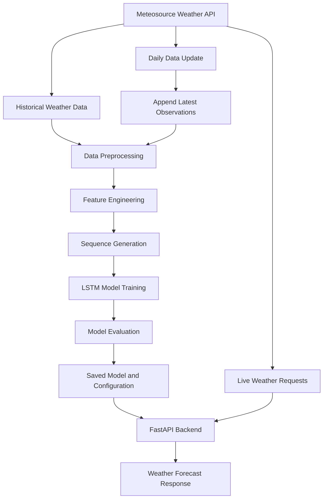

# AI Weather Forecaster

An AI-powered weather forecasting system that uses a **Bidirectional Long Short-Term Memory (LSTM) neural network** to predict weather conditions up to 24 hours ahead. The system processes historical weather data, automatically retrieves new observations, periodically retrains its forecasting model, and provides predictions through a FastAPI backend.
The project combines time-series forecasting, automated data engineering, deep learning, and API development to create a continuously updated weather prediction system.

---

## Overview
This project uses a recurrent neural network, specifically an LSTM-based architecture, to learn patterns from sequential weather observations.
The system is designed to:

- Collect historical weather data from an external weather API.
- Process and normalize the data for neural network training.
- Train and evaluate region-specific forecasting models.
- Predict weather conditions up to 24 hours into the future.
- Retrieve new observations and periodically update trained models.
- Serve AI-generated forecasts and live weather information through a FastAPI backend.

## Key Features

### 1. Deep Learning Weather Forecasting

Uses a Bidirectional LSTM followed by an LSTM layer and fully connected neural network layers to learn temporal patterns in historical weather data
and generate weather predictions for the next 24 hours.

### 2. Automated Data Collection

Retrieves historical hourly weather observations from the Meteosource API and appends newly collected records to existing datasets.

### 3. Periodic Model Retraining

The daily update process prepares the latest available dataset and retrains the model so that it can incorporate newer weather observations.

### 4. Live Global Weather

The FastAPI backend can retrieve current weather conditions for locations around the world supported by the Meteosource API.

## How It Works

The system follows a pipeline from historical data collection to forecast delivery.

1. **Data collection:** Historical hourly weather data is retrieved from Meteosource and stored in CSV files.
2. **Preprocessing:** The raw data is cleaned, transformed, normalized, and enriched with temporal features.
3. **Sequence generation:** Consecutive observations are converted into input sequences and corresponding future targets.
4. **Model training:** The LSTM network learns relationships between historical weather conditions and future observations.
5. **Evaluation:** The trained model is evaluated using held-out time-series data.
6. **Forecast generation:** The backend loads the appropriate regional model and supporting configuration to generate predictions.
7. **Automated updates:** Newly available historical observations are appended to the dataset, and the model is periodically retrained.
8. **API delivery:** Forecasts and live weather data are returned through FastAPI endpoints.

### System Workflow

---

## Model Architecture

The forecasting system uses a recurrent neural network based on **Long Short-Term Memory (LSTM)**.
LSTM networks are designed to learn these dependencies while helping mitigate the vanishing-gradient problem associated with conventional recurrent networks.

### Model Layers

The model summary reported in the project contains the following layers:

| Layer | Output Shape | Parameters |
|---|---|---:|
| Input | `(None, 168, 56)` | 0 |
| Layer Normalization 1 | `(None, 168, 56)` | 112 |
| Bidirectional | `(None, 168, 96)` | 40,320 |
| Dropout 1 | `(None, 168, 96)` | 0 |
| Layer Normalization 2 | `(None, 168, 96)` | 192 |
| LSTM | `(None, 32)` | 16,512 |
| Dropout 2 | `(None, 32)` | 0 |
| Dense 1 | `(None, 64)` | 2,112 |
| Dropout 3 | `(None, 64)` | 0 |
| Dense 2 | `(None, 32)` | 2,080 |
| Dropout 4 | `(None, 32)` | 0 |
| Dense 3 | `(None, 96)` | 3,168 |

The architecture has **64,496 trainable parameters**.

The input sequence contains 168 time steps and 56 features per time step. The network then processes the sequence, extracts temporal information, and maps the learned representation to the forecast output.

### Main Architectural Components

**Bidirectional LSTM**

Processes the input sequence in forward and backward directions to capture relationships across the supplied historical window.

**LSTM layer**

Compresses the sequence representation into a 32-unit output used by the fully connected layers.

**Layer normalization**

Normalizes activations to help stabilize training.

**Dropout**

Randomly deactivates a fraction of units during training to help reduce overfitting.

**Dense layers**

Use 64 and 32 units with ReLU activation before the final linear output layer produces numerical predictions.

**Regularization and optimization**

The report describes L1/L2 weight regularization, the Adam optimizer, and gradient clipping with a norm limit of 1.0.

---

## Data Processing and Feature Engineering

The quality and structure of time-series inputs are important to forecasting performance. The preprocessing pipeline converts raw observations into a format suitable for recurrent neural networks.

### 1. Temporal Feature Encoding

Cyclical encoding allows the model to learn periodic relationships, such as the transition from one hour to the next and recurring time-of-day patterns.

### 2. Lag Features

Previous values of weather variables are included at multiple time intervals:

- 1 hour
- 3 hours
- 6 hours
- 12 hours
- 24 hours

These lagged features provide additional historical context to the model.

### 3. Differences and Rolling Statistics

The pipeline calculates differences and rolling statistics to represent recent changes and trends in weather conditions.

### 4. Missing-Value Handling

Missing values are handled using forward filling and backward filling during preprocessing.

### 5. Robust Scaling

The pipeline uses `RobustScaler`, which scales features using their median and interquartile range (IQR) rather than relying on the mean and standard deviation.
This makes the scaling procedure less sensitive to extreme observations.

## Backend API

The backend is built to serve these two categories of requests:

- AI-generated forecasts from the trained model.
- Current weather retrieved from the external weather API.

---
